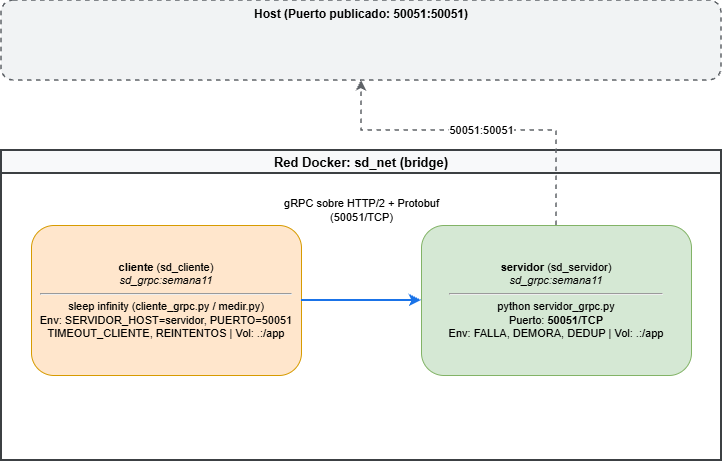

# Reporte de Servicios Cliente-Servidor

**Equipo:** AngeloM_SebastianC  
**Integrantes:** Angelo Muñoz, Sebastián Cárcamo  
**Dominio:** Sensores IoT  
**Repositorio:** https://github.com/V4stoL0rde/AngeloM_SebastianC_SD  
**Fecha:** 20-11-2026  

---

## 1. El servicio y su dominio

El servicio distribuido desarrollado durante el semestre aborda la recolección, consulta y gestión centralizada de telemetría proveniente de sensores IoT (como temperatura ambiente, humedad o presión de calderas) en escenarios de monitoreo continuo. En este tipo de arquitecturas, diversos nodos periféricos capturan mediciones físicas de forma periódica y las envían a un servidor central. El sistema asegura que dicha transmisión sea concurrente y tolerante a fallos de red, evitando la pérdida o duplicación de datos frente a microcortes o latencias elevadas.

La interacción con la plataforma se organiza en torno a dos perfiles operativos:

- **Nodos sensores y agentes recolectores (productores):** Dispositivos o procesos en terreno que reportan nuevas lecturas al servidor cada vez que cumplen un ciclo de muestreo o detectan cambios en una variable física.
- **Sistemas de monitoreo y operadores (consumidores):** Aplicaciones de supervisión que consultan el estado general de la red en tiempo real, revisan métricas puntuales o dan de baja equipos obsoletos.

Para gestionar el ciclo de vida de estos datos, la lógica de negocio implementada en `dominio.py` define cuatro operaciones principales, todas protegidas contra condiciones de carrera mediante exclusión mutua (`threading.Lock`):

- **`actualizar(sensor, valor)`:** Registra un sensor en el almacenamiento del servidor o sobrescribe su última lectura disponible. Al ser una operación de escritura, modifica el estado compartido del sistema.
- **`leer(sensor)`:** Retorna el valor más reciente asociado a un identificador específico. Si el sensor no se encuentra registrado, levanta una excepción controlada (`ErrorDominio`). Es una consulta de solo lectura e idempotente.
- **`listar()`** *(referida como `REPORTE` en iteraciones iniciales)*: Entrega una vista completa (en formato de diccionario o colección) de los sensores activos junto con sus valores actuales, sin alterar el estado interno.
- **`eliminar(sensor)`:** Borra de manera permanente un sensor y su registro asociado. Al igual que la actualización, modifica el estado del servidor y exige control de deduplicación frente a posibles reintentos de red.

---

## 2. Arquitectura y topología

Para la implementación definitiva del servicio seleccionamos la arquitectura basada en **gRPC** (desarrollada en `semana11/`), desplegada mediante contenedores aislados en Docker Compose sobre una red puente (*bridge*) interna dedicada.



### Descripción de nodos, red y protocolos

- **Red interna `sd_net` (Docker Bridge Network):** Red virtual privada configurada en `semana11/docker-compose.yml` que aísla el tráfico entre contenedores y resuelve los nombres DNS internos de forma automática según cada servicio (`servidor` y `cliente`).
- **Nodo `sd_servidor` (Contenedor servidor):** Levanta el proceso `servidor_grpc.py` a partir de la imagen `sd_grpc:semana11`. Opera como servidor RPC concurrente exponiendo el puerto TCP `50051` (mapeado al host como `50051:50051`). Internamente instancia la clase `ControlSensoresServicer` (generada desde `proto/servicio.proto`), administra una tabla de deduplicación en memoria cuando `DEDUP=1` para asegurar una semántica *at-most-once*, y delega el almacenamiento en RAM al módulo `dominio.py`.
- **Nodo `sd_cliente` (Contenedor cliente):** Ejecuta los scripts consumidores (`cliente_grpc.py` y `medir.py`) dentro de la misma red `sd_net`. Instancia el stub `ControlSensoresStub` apuntando a `servidor:50051` y gestiona tres tareas: generar los identificadores únicos de cada petición (`id_solicitud` de 8 caracteres hexadecimales), controlar los tiempos límite por llamada (`TIMEOUT_CLIENTE`) y aplicar la política de reintentos (`REINTENTOS`) frente a fallos temporales de red.
- **Protocolo de comunicación (gRPC sobre HTTP/2 + Protocol Buffers):** El intercambio de mensajes entre `sd_cliente` y `sd_servidor` por el puerto `50051` corre sobre HTTP/2 como transporte multiplexado, empleando serialización binaria mediante Protocol Buffers (`proto3`).

---

## 3. Evolución del contrato

A lo largo del curso, la interfaz mediante la cual los clientes invocan operaciones sobre el servicio de sensores IoT evolucionó desde comandos de texto plano delimitados por saltos de línea hasta llamadas a procedimientos remotos fuertemente tipados y objetos distribuidos.

La siguiente tabla muestra **exactamente la misma operación de escritura (`actualizar` el sensor `temp_salon` con valor `21.5`)** en cada etapa de nuestro repositorio:

| Etapa | Semana | Dónde está el contrato | Ejemplo de la misma operación (`actualizar temp_salon 21.5`) |
| :--- | :--- | :--- | :--- |
| **Protocolo de texto sobre TCP** | 4 y 6 | `semana04/protocolo.md` y `semana06/protocolo.md` (v2) | **Petición TCP (UTF-8):**<br>`ACTUALIZAR temp_salon 21.5\n`<br>**Respuesta TCP:**<br>`OK temp_salon=21.5\n` |
| **REST sobre HTTP** | 7 | `semana07/interfaz_http.md` y `semana07/api.py` | **Petición HTTP:**<br>`POST /sensores/temp_salon/lecturas HTTP/1.1`<br>`Content-Type: application/json`<br>`{"valor": 21.5}`<br>**Respuesta HTTP (`201 Created`):**<br>`{"sensor": "temp_salon", "valor": 21.5, "replica": "api1"}` |
| **Mensajes estructurados** | 9 | `semana09/protocolo.md` (v3) y `semana09/mensajes.py` | **Trama binaria enmarcada `[largo 4B][cuerpo JSON/bin]`:**<br>`{"version": 2, "id": 7, "operacion": "ACTUALIZAR", "argumentos": ["temp_salon", "21.5"]}`<br>**Respuesta:**<br>`{"id": 7, "estado": "OK", "datos": ["temp_salon=21.5"], "error": ""}` |
| **JSON-RPC 2.0** | 10 | `semana10/rpc.py` | **Petición `POST /rpc`:**<br>`{"jsonrpc": "2.0", "method": "actualizar", "params": {"sensor": "temp_salon", "valor": "21.5"}, "id": 1}`<br>**Respuesta:**<br>`{"jsonrpc": "2.0", "result": {"sensor": "temp_salon", "valor": "21.5"}, "id": 1}` |
| **gRPC (Protobuf)** | 11 | `semana11/proto/servicio.proto` y `semana11/contrato.md` | **Invocación de Stub:**<br>`stub.Actualizar(ActualizarSolicitud(id_solicitud="85afb482", sensor="temp_salon", valor="21.5"))`<br>**Respuesta (`SensorRespuesta`):**<br>`sensor: "temp_salon", valor: "21.5"` (binario Protobuf) |
| **Objetos remotos (Pyro5)** | 12 | `semana12/laboratorio/objetos.py` | **Invocación transparente sobre Proxy:**<br>`proxy = Proxy("PYRONAME:sd.AngeloM_SebastianC.sensores@nombres:9090")`<br>`proxy.actualizar("temp_salon", "21.5")` |

### Análisis de ganancias y pérdidas en cada transición

1. **De Texto TCP (Semanas 4–6) a REST HTTP (Semana 7):**
   - **Qué se ganó:** Estandarización mediante verbos HTTP, códigos de estado semánticos (`200`, `201`, `404`, `422`, `503`), validación automática de tipos y esquemas con Pydantic (`api.py`) —evitando inyecciones de saltos de línea `\n` en el socket— y balanceo de carga horizontal entre réplicas (`api1`, `api2`) mediante Nginx.
   - **Qué se perdió:** Aumentó la sobrecarga (*overhead*) de red por las cabeceras HTTP y el formato JSON, además de introducir un salto de red adicional entre el proxy inverso, la API sin estado y el servidor TCP.
2. **De REST (Semana 7) a Mensajes Estructurados Enmarcados (Semana 9):**
   - **Qué se ganó:** Control explícito sobre el nivel de transporte mediante prefijo de longitud de 4 bytes (eliminando ambigüedades de lectura en *streams* TCP), versionado explícito del protocolo (`version: 2`), correlación de peticiones (`id`) y serialización binaria (`codec=bin`), reduciendo el tamaño de las solicitudes en un $71\%$ respecto a JSON ($21.8\text{ B}$ vs. $74.7\text{ B}$).
   - **Qué se perdió:** Se sacrificó la legibilidad humana directa en el tráfico de red (al usar el codec binario) y aumentó la complejidad de mantener manualmente el serializador/deserializador en `codec.py`.
3. **De Mensajes Estructurados (Semana 9) a JSON-RPC 2.0 (Semana 10):**
   - **Qué se ganó:** Adopción de un estándar abierto reconocido (`JSON-RPC 2.0`), soporte nativo para llamadas en lote (*batch*), notificaciones sin respuesta y códigos de error estandarizados (`-32601`, `-32602`, `-32000`) sin tener que mantener un protocolo propio.
   - **Qué se perdió:** Al volver a texto JSON sobre HTTP, perdimos la eficiencia de ancho de banda lograda con el codec binario de la semana 9 y nos quedamos sin un lenguaje de definición de interfaz (IDL) que valide los tipos en tiempo de compilación.
4. **De JSON-RPC 2.0 (Semana 10) a gRPC (Semana 11):**
   - **Qué se ganó:** Un contrato estricto e independiente del lenguaje definido en `servicio.proto` con generación automática de *stubs* (`ControlSensoresStub` y `ControlSensoresServicer`), serialización binaria de alto rendimiento con Protocol Buffers, compatibilidad hacia adelante y atrás mediante numeración de campos, soporte nativo de *deadlines* y la incorporación formal de `id_solicitud` para tolerancia a fallos.
   - **Qué se perdió:** Ya no es posible inspeccionar mensajes directamente con herramientas de texto plano como `curl` o navegadores web sin utilidades intermediarias (como `grpcurl`), y quedamos acoplados al ecosistema HTTP/2.
5. **De gRPC (Semana 11) a Objetos Remotos con Pyro5 (Semana 12):**
   - **Qué se ganó:** Transparencia de acceso y ubicación casi total en Python: el cliente invoca métodos remotos como si fueran objetos locales y permite pasar objetos con estado **por referencia** (`LoteSensores`), encapsulando transacciones complejas en el servidor.
   - **Qué se perdió:** Fuerte acoplamiento al lenguaje Python (ruptura de interoperabilidad multilenguaje), dependencia crítica de un servidor de nombres centralizado (`Pyro.NameServer`) como punto único de falla, y riesgos de referencias colgantes cuando finaliza el ciclo de vida de los objetos remotos.

---

## 4. Mecanismo elegido y justificación

Para la arquitectura definitiva del servicio y nuestra demostración en vivo (Evaluación 5), elegimos **gRPC (Semana 11)**.

A continuación contrastamos **gRPC** frente a dos alternativas implementadas en el repositorio —**JSON-RPC 2.0 (Semana 10)** y **Objetos Remotos con Pyro5 (Semana 12)**— aplicando los criterios del cuadro comparativo de la semana 10 (`semana10/cuadro_comparativo.md`) y los requisitos del dominio de **Sensores IoT**:

| Criterio | gRPC (Mecanismo Elegido) | Alternativa 1: JSON-RPC 2.0 | Alternativa 2: Objetos Remotos (Pyro5) |
| :--- | :--- | :--- | :--- |
| **Modelo de comunicación** | Llamadas a procedimientos remotos (RPC) orientadas a servicios sin estado (*stateless*) por defecto, con contratos explícitos. | Procedimientos remotos sin estado basados en intercambio de mensajes JSON sobre HTTP. | Objetos distribuidos con estado e identidad remota gestionados mediante proxies y referencias. |
| **Contrato o IDL** | **IDL estricto (`proto3`):** Definido en `servicio.proto` con tipado fuerte, numeración de campos y generación automática de *stubs*. | **Sin IDL formal:** Contrato implícito documentado en código (`rpc.py`); validación dinámica en tiempo de ejecución. | **Sin IDL separado:** Contrato acoplado directamente a la firma de las clases Python (`ControlSensores` y `LoteSensores`). |
| **Transporte y formato** | **HTTP/2 + Protocol Buffers (binario):** Multiplexación de peticiones sobre una sola conexión TCP y *payloads* compactos. | **HTTP/1.1 + JSON (texto UTF-8):** Mayor tamaño de trama por claves repetidas y cabeceras HTTP verbosas. | **Protocolo propietario `PYRO` + serializador `serpent`:** Binario/texto específico de Python sobre TCP directo. |
| **Interoperabilidad de lenguajes** | **Multilenguaje nativo:** Permite que sensores embebidos en C/C++, Go o Rust envíen datos a un servidor en Python. | **Multilenguaje universal:** Cualquier dispositivo capaz de hacer peticiones HTTP y *parsear* JSON puede integrarse. | **Monolenguaje (exclusivo Python):** Impide integrar microcontroladores o nodos IoT programados en C/C++ o Go. |
| **Gestión de errores y timeouts** | Códigos de estado estandarizados (`UNAVAILABLE`, `DEADLINE_EXCEEDED`, `FAILED_PRECONDITION`) y propagación nativa de *deadlines*. | Códigos numéricos estándar (`-32601`, `-32602`, `-32000`), pero depende de la capa HTTP para gestionar *timeouts*. | Excepciones remotas de Python (`CommunicationError`, `NamingError`), propensas a referencias colgantes. |
| **Adecuación al dominio Sensores IoT** | **Alta:** Minimiza el consumo de ancho de banda en redes de sensores, garantiza evolución segura del esquema y soporta deduplicación. | **Aceptable para paneles web**, pero ineficiente para telemetría de alta frecuencia por la sobrecarga de JSON. | **Inadecuada para producción IoT:** Requiere un servidor de nombres adicional (`nombres`) y ata todos los nodos a Python. |

### Justificación vinculada al dominio de Sensores IoT

En el escenario de **telemetría y control de sensores IoT**, gRPC supera a JSON-RPC 2.0 y Pyro5 por cuatro razones técnicas comprobadas en nuestro repositorio:

1. **Eficiencia de ancho de banda en nodos IoT:** Los dispositivos de monitoreo suelen operar en redes inalámbricas o enlaces industriales con ancho de banda limitado. Como comprobamos en el benchmark de la semana 9 y en la medición de `medir.py`, la serialización binaria de Protobuf reduce el tamaño de respuesta de una consulta `listar` a **$46\text{ bytes}$** frente a los **$73\text{ bytes}$** de Pyro5 (un **$37\%$ menos de carga útil**) y frente a más de $110\text{ bytes}$ en formatos JSON equivalentes.
2. **Heterogeneidad de hardware y lenguajes:** En un despliegue IoT real, los nodos sensores (como placas ESP32 o pasarelas Linux embebidas) suelen programarse en **C, C++, Rust o Go**, mientras que el backend analítico corre en **Python**. Pyro5 queda descartado porque exige que cliente y servidor ejecuten Python y compartan las mismas clases; gRPC, en cambio, genera *stubs* nativos para más de diez lenguajes a partir del mismo `servicio.proto`.
3. **Evolución segura de contratos sin detener sensores en campo:** Cuando agregamos nuevas operaciones al sistema —como ocurrió en la semana 11 al incorporar `Eliminar` en `servicio.proto`—, los sensores desplegados en campo no pueden actualizarse simultáneamente. Gracias a la compatibilidad hacia adelante y hacia atrás de Protocol Buffers, los clientes antiguos siguen operando sin errores de deserialización.
4. **Control nativo de latencia (*Deadlines*) e idempotencia:** En monitoreo de procesos críticos (como presión de calderas), una lectura tardía carece de valor. gRPC incorpora *deadlines* por llamada (`DEADLINE_EXCEEDED`) y permite acoplar el campo `id_solicitud` en mensajes de escritura (`ActualizarSolicitud`, `EliminarSolicitud`) para evitar lecturas duplicadas ante reintentos de red.

---

## 5. Evidencia de funcionamiento y medición

### Evidencia de comunicación entre contenedores Docker

Para comprobar el funcionamiento del servicio distribuido en red, levantamos los contenedores `sd_servidor` y `sd_cliente` definidos en `semana11/docker-compose.yml`. Desde el contenedor cliente (`sd_cliente`) ejecutamos operaciones de escritura y consulta contra el contenedor servidor (`sd_servidor`) a través de la red `sd_net`:

```text
PS C:\Users\scarc\Downloads\AngeloM_SebastianC_SD-main\AngeloM_SebastianC_SD-main\semana11> docker compose up -d --build
[+] up 3/3
 ✔ Image sd_grpc:semana11 Built                                    1.1s
 ✔ Container sd_servidor Started                                   3.8s
 ✔ Container sd_cliente Started                                    3.5s

PS C:\Users\scarc\Downloads\AngeloM_SebastianC_SD-main\AngeloM_SebastianC_SD-main\semana11> docker compose exec cliente python cliente_grpc.py actualizar temp_salon 21.5
[cliente] intento 1, id_solicitud=85afb482, deadline 2 s
[cliente]   OK sensor temp_salon = 21.5

PS C:\Users\scarc\Downloads\AngeloM_SebastianC_SD-main\AngeloM_SebastianC_SD-main\semana11> docker compose exec cliente python cliente_grpc.py actualizar presion_caldera 101.3
[cliente] intento 1, id_solicitud=b0278c2b, deadline 2 s
[cliente]   OK sensor presion_caldera = 101.3
```

### Benchmark comparativo con `medir.py`

La siguiente tabla resume las mediciones ejecutando la misma operación de consulta (`listar`) sobre el mecanismo elegido (**gRPC**) y la alternativa (**Pyro5**):

| Mecanismo | Operación | $n$ | $p_{50}$ ($\text{ms}$) | $p_{95}$ ($\text{ms}$) | Media ($\text{ms}$) | Máx ($\text{ms}$) | Respuesta ($\text{bytes}$) |
| :--- | :--- | :--- | :--- | :--- | :--- | :--- | :--- |
| **gRPC** | `listar` | $200$ | $0.42$ | $0.52$ | $0.43$ | $0.74$ | $46$ |
| **Pyro5** | `listar` | $200$ | $0.10$ | $0.19$ | $0.12$ | $0.64$ | $73$ |

### Interpretación de los resultados e impacto en el dominio

- **Diferencia en tamaño de respuesta ($46\text{ bytes}$ en gRPC vs. $73\text{ bytes}$ en Pyro5):**  
  gRPC serializa únicamente los valores de los campos identificados por etiquetas numéricas en `ListarRespuesta` mediante Protocol Buffers, logrando una carga útil **$37\%$ más compacta**. En cambio, Pyro5 utiliza el serializador `serpent`, que incluye metadatos de tipos de Python, nombres explícitos de las claves del diccionario (`"temp_salon"`, `"presion_caldera"`) y encabezados de trama propios del protocolo `PYRO`.

- **Diferencia de latencia ($0.42\text{ ms}$ $p_{50}$ en gRPC vs. $0.10\text{ ms}$ $p_{50}$ en Pyro5):**  
  En un entorno local Docker sobre la misma máquina anfitriona (donde el *Round-Trip Time* de red es casi nulo), Pyro5 obtiene una latencia marginalmente menor ($0.32\text{ ms}$ de diferencia en mediana) porque opera directamente sobre un socket TCP persistente sin el procesamiento de tramas HTTP/2 ni la validación estructural de esquemas que realiza el motor C-core de gRPC en cada invocación. Además, durante la medición de Pyro5 el proxy ya tenía resuelta la URI en caché, evitando consultar al servidor de nombres (`nombres:9090`).

- **Impacto en el dominio de Sensores IoT:**
  - **En latencia:** Una diferencia de $0.32\text{ ms}$ es despreciable para el monitoreo de sensores físicos (donde los intervalos de muestreo oscilan entre cientos de milisegundos y varios segundos) y ambos mecanismos mantienen latencias máximas por debajo de $1\text{ ms}$ ($0.74\text{ ms}$ y $0.64\text{ ms}$).
  - **En ancho de banda y escalabilidad:** La reducción de $73\text{ bytes}$ a $46\text{ bytes}$ por mensaje sí marca diferencia en despliegues IoT con cientos de nodos reportando continuamente, ya que disminuye la congestión en enlaces restringidos. gRPC logra un mejor compromiso al sacrificar fracciones de milisegundo de CPU a cambio de menor tráfico de red, tipado estricto e interoperabilidad multilenguaje.

---

## 6. Análisis de fallos

| Falla provocada | Qué esperábamos según la teoría | Qué observamos | Qué haríamos para tolerarla |
| :--- | :--- | :--- | :--- |
| **Servidor cae a mitad de una llamada** (Semana 11) | Según la teoría de RPC (Tanenbaum & Van Steen), el cierre abrupto del socket TCP debe provocar que el *stub* del cliente detecte la pérdida de conexión (`UNAVAILABLE`) y deje la operación en estado incierto si ya había comenzado a procesarse. | El cliente recibió inmediatamente el código `UNAVAILABLE` con detalle `Socket closed`. Al reiniciar el contenedor, el almacenamiento en memoria apareció vacío (`(vacío)`), confirmando una semántica de fallo volátil y pérdida de estado no persistido. | 1. Persistir el estado de `dominio.py` en almacenamiento no volátil (SQLite, Redis o PostgreSQL) en lugar de un diccionario en RAM.<br>2. Configurar políticas de reinicio automático en Docker (`restart: unless-stopped`) y reintentos con *backoff* exponencial en el cliente. |
| **Servidor cae y vuelve** (Semana 12) | Al caer el proceso servidor, el proxy remoto debe lanzar una excepción de comunicación; al reiniciarse el servidor, el estado en memoria RAM se pierde y cualquier referencia a objetos dinámicos previos queda inválida (referencia colgante). | 1. El cliente monitor (`vigilar`) reportó `FALLA de comunicación` (`CommunicationError`) cada segundo y luego se reconectó automáticamente al volver el servidor, obteniendo `sensores {}` (estado perdido).<br>2. Al invocar un `LoteSensores` abierto antes de la caída, el servidor respondió `CommunicationError` (`unknown object`), evidenciando una referencia colgante. | 1. Desacoplar el estado hacia una base de datos externa para sobrevivir a reinicios del servidor.<br>2. Hacer que el cliente capture `unknown object` / `CommunicationError` y ejecute un flujo de recuperación que vuelva a solicitar `abrir_lote()` para reconstruir la sesión. |
| **Servidor de nombres cae** (Semana 12) | El *Name Server* constituye un punto único de falla para el descubrimiento inicial (resolución de URI), pero los clientes que ya resolvieron la referencia directa (`PYRO:sensores@servidor:9100`) deben poder seguir operando sin interrupciones. | 1. El cliente `vigilar` (con URI ya resuelta) siguió funcionando sin interrupciones mientras `nombres` estuvo muerto.<br>2. Un cliente nuevo falló con `NamingError` mientras `nombres` estuvo caído, y con `unknown name` cuando `nombres` revivió con su tabla en memoria vacía, recuperándose recién tras ejecutar `restart servidor`. | 1. Activar el re-registro periódico automático en `servidor_pyro.py` (`REREGISTRO > 0` en `.env`) para que el servidor vuelva a publicar su URI sin intervención manual.<br>2. Replicar el servicio de nombres o eliminar esta dependencia usando DNS interno directo de Docker + gRPC. |

### Semántica de fallo actual vs. semántica requerida por el dominio

- **Semántica de fallo actual del servicio:**  
  Tal como comprobamos en la tabla de fallas intermedias de `semana11/observaciones.md`, el servicio ofrece semántica configurable según la bandera `DEDUP`:
  1. Con la configuración por defecto (`DEDUP=0` y `REINTENTOS=0`), ofrece semántica ***Maybe* (quizás)**: ante un `DEADLINE_EXCEEDED`, el cliente no sabe si la actualización se aplicó o no. Si se habilitan reintentos (`--reintentos 2`) sin deduplicación (`DEDUP=0`), el servicio cae en semántica ***At-least-once* (al menos una vez)**, ejecutando la mutación múltiples veces en el servidor (como se vio en los logs del Caso 3, donde `Actualizar id=6d95cdcc` se ejecutó dos veces).
  2. Al activar el filtro de deduplicación (`DEDUP=1`) junto con el envío de `id_solicitud` desde `cliente_grpc.py`, el servicio alcanza una semántica ***At-most-once* (como máximo una vez)** ante fallos de red o demoras: el servidor detecta el `id_solicitud` repetido y retorna el resultado almacenado sin volver a ejecutar la operación (Caso 4: `Actualizar id=c4ae0628 repetido, devuelvo lo guardado SIN aplicar de nuevo`). Sin embargo, ante una caída abrupta del contenedor (`kill servidor`), la tabla de deduplicación en memoria se pierde.

- **Semántica que necesita el dominio de Sensores IoT:**  
  El dominio requiere una combinación diferenciada según el tipo de operación:
  - **Para operaciones de consulta (`listar`, `leer`):** Basta con semántica ***At-least-once* (al menos una vez)**, ya que son operaciones idempotentes que no alteran el estado del sistema y pueden reintentarse libremente ante pérdida de paquetes.
  - **Para operaciones de escritura y mutación de estado (`actualizar`, `eliminar`):** El dominio exige semántica ***At-most-once* (como máximo una vez)** respaldada por almacenamiento persistente. En un sistema de monitoreo o control industrial, ejecutar dos veces una operación de eliminación o reordenar escrituras duplicadas tras un microcorte de red corrompe el historial de mediciones o provoca errores `FAILED_PRECONDITION` falsos en el cliente.

---

## 7. Referencias

- Coulouris, G., Dollimore, J., Kindberg, T., & Blair, G. (2011). *Distributed Systems: Concepts and Design* (5ª ed.). Addison-Wesley. Capítulo 5: Remote Invocation.
- Documentación oficial de gRPC: *Core Concepts, Architecture and Lifecycle (Deadlines, Status Codes & Proto3)*. https://grpc.io/docs/what-is-grpc/core-concepts/
- Kleppmann, M. (2017). *Designing Data-Intensive Applications: The Big Ideas Behind Reliable, Scalable, and Maintainable Systems*. O'Reilly Media. Capítulo 4: Encoding and Evolution y Capítulo 8: The Trouble with Distributed Systems.
- Documentación oficial de Pyro5: *Name Server, Proxies and Instance Modes*. https://pyro5.readthedocs.io/
- Tanenbaum, A. S., & Van Steen, M. (2017). *Distributed Systems: Principles and Paradigms* (3ª ed.). CreateSpace Independent Publishing Platform. Capítulo 4: Communication (Secciones 4.2 Remote Procedure Call y 4.3 Message-Oriented Communication).